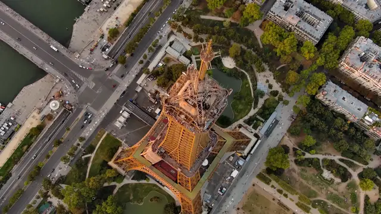
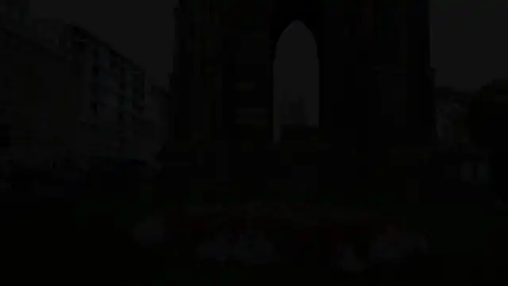

# Video Aesthetic Editing

一条命令，把一组原始视频按一句话的要求剪成成片：读入 `case.json`，
切分镜头、听写对白、看图打标签、写大纲、审片，按目标时长输出 1080p
成片，保留原声，切点不切断对白。默认全程在本机运行，不需要独立显卡；
写大纲和审片也可以交给云端，只发文字。




<sub>样片：输入两条共 34 分钟的巴黎航拍和一句“把白天的埃菲尔铁塔航拍和
夜晚的巴黎街景合成一条从白天到夜晚的巴黎短片”，自动剪出的 60 秒成片
（12 个镜头），动图每个镜头取中间 1.5 秒，无声。素材：Eiffel Tower,
Paris 2022（the Dronalist）和 The City of Lights, Paris, France 2022
（ALL IN 8K），Wikimedia Commons，CC BY 3.0；本动图按 CC BY 3.0 发布。</sub>

每一步怎么做、为什么这样做，见 [技术路径](TECHNICAL.md) 和
[设计说明](ab_eval/DESIGN.md)。

## 一条命令

```bash
python -m ab_eval.run case.json out/
```

`case.json` 写明素材和要求：

```json
{
  "id": "case-10",
  "sources": [{"file": "case-10-1.webm", "sha256": "…"}],
  "request": {
    "target_seconds": 60,
    "format": {"music": false, "subtitles": false},
    "instruction": "把白天的埃菲尔铁塔航拍和夜晚的巴黎街景合成一条从白天到夜晚的巴黎短片"
  }
}
```

输出到 `out/`：

| 文件 | 内容 |
|---|---|
| `output.mp4` | 成片：1080p（竖屏素材为主时 1080×1920），原声 |
| `timeline.json` | 每个镜头的来源、起止时间和选用理由 |
| `report.html` | 可视化报告：大纲、审片前后的镜头、关键帧 |
| `prompts/` | 写大纲和审片时发给模型的提示词 |
| `trace.json`、`steps.json` | 各步耗时，打标预处理和用户指令剪辑分开计 |

规划模型：不设 `ANTHROPIC_API_KEY` 时用本地 Qwen3.5-4B，断网也能
出片；设了就由云端写大纲和审片（`--planner local` 可强制本地）。模型
服务由入口按步骤自动启停，同一时刻只运行一个模型。部署、模型清单和
全部选项见 [部署说明](ab_eval/testset/README.md)，链路说明见
[pipeline.yaml](ab_eval/pipeline.yaml)。

## 流水线

分两个阶段：打标预处理只取决于素材，结果按视频内容缓存；用户指令剪辑
读要求出片，同一素材换要求只跑这一段。

```text
case.json + 素材
  │
  ├─ 打标预处理
  │    check      校验 case.json，按 sha256 核对素材
  │    prepare    听写对白；按镜头切换和渐变切分，切点挪到句子之间
  │    shortlist  不用模型，按画面信号筛出候选片段
  │    analyze    4B 判断素材类型，看关键帧给候选打标签；DOVER 画质分
  │    index      标签、对白和关键帧编成向量（EmbeddingGemma 2）
  │    catalog    4B 按时间分块总结，归成场景并写标题和概况
  │
  └─ 用户指令剪辑
       edit       写大纲 → 按大纲检索出粗剪 → 审片定出镜头、顺序和时长
       render     1080p 渲染：原声，接缝交叉淡化，换段落处溶解
```

- **对白不切断**：镜头切到半句话时扩到整句；超出目标时长时只压缩没有
  对白的镜头。
- **大纲加审片**：大纲写片名、分段和每段要的画面；审片看开场、收尾、
  相邻镜头的景别变化、每个镜头的时长，以及要求里的时间先后。
- **画质**：从原片渲染；HDR（PQ）映射为 SDR；暗场按风格处理，片头
  片尾字幕和黑场不进成片。

## 效果

10 个测试用例，素材都来自公开许可的视频（Wikimedia Commons、Netflix
Open Content、Blender 开放电影）：

| 用例 | 素材 | 要求 | 目标 | 成片 | 画幅 | 片名 |
|---|---|---|---|---|---|---|
| 01 | 12 分钟 | 剪成一条悬疑感的电影预告片，保留关键对白，不剧透结局 | 60 s | 60.0 s，23 个镜头 | 1920×1080 | 子午线 |
| 02 | 20 分钟 | 按时间顺序讲完博主在上海的这一天，保留说话的关键片段 | 90 s | 90.0 s，18 个镜头 | 1920×1080 | 上海的一天 |
| 03 | 67 分钟 | 剪成一条爱丁堡城市短片，挑最有代表性的街景和建筑 | 60 s | 60.0 s，15 个镜头 | 1920×1080 | 石头城爱丁堡 |
| 04 | 38 分钟 | 把两集合成一条深圳旅行故事，以冲浪为高潮 | 60 s | 60.0 s，17 个镜头 | 1920×1080 | 深圳，去冲浪 |
| 05 | 28 分钟 | 把两段合成一条西安一日短片：白天古迹、夜晚大唐不夜城、回民街小吃 | 60 s | 60.0 s，16 个镜头 | 1920×1080 | 西安一日 |
| 06 | 13 分钟 | 按春夏秋冬的顺序剪成一条岩国城市宣传片 | 60 s | 60.1 s，17 个镜头 | 1920×1080 | 岩国四季 |
| 07 | 13 分钟 | 挑最漂亮的冰雕和灯光，剪成一条哈尔滨冰雪大世界夜景短片 | 45 s | 45.0 s，8 个镜头 | 1920×1080 | 冰雪大世界之夜 |
| 08 | 12 分钟 | 剪成一条不剧透结局的电影预告片 | 60 s | 60.0 s，21 个镜头 | 1920×1080 | 钢铁之泪 |
| 09 | 2 分钟 | 把两段合成一条竖屏短视频，剪辑点卡在音乐节拍上 | 20 s | 20.2 s，7 个镜头 | 1080×1920 | 今夜狂欢 |
| 10 | 34 分钟 | 把白天的埃菲尔铁塔航拍和夜晚的巴黎街景合成一条从白天到夜晚的巴黎短片 | 60 s | 60.1 s，12 个镜头 | 1920×1080 | 巴黎，从白昼到夜晚 |

这 10 条成片的大纲和审片由云端规划，打标预处理在本机。每个用例的
时间线、报告、计时和提示词在 [ab_eval/results/](ab_eval/results/)；
成片视频不入库。06 的素材里没有冬天的画面，大纲如实标为找不到，成片
只有春夏秋三季。

开发机（Core Ultra 5 225U、Intel 核显）上，打标预处理每个用例
23–175 分钟，随素材长度增长；用户指令剪辑（不含规划模型的回答时间）
0.5–6 分钟，4K HDR 素材（01）约 12 分钟。在限定的 8 CPU、3.4 GiB
容器里的耗时和内存峰值还没有测。

## 安装

需要 Python 3.11。PyAV 自带 FFmpeg 库，无需另装 ffmpeg。

```bash
python -m venv .venv
```

```bash
.venv/Scripts/python -m pip install -r requirements.txt
```

```bash
.venv/Scripts/python -m pip install torch torchvision --index-url https://download.pytorch.org/whl/cpu
```

DOVER 代码放在 `third_party/`（不入库）：

```bash
git clone https://github.com/VQAssessment/DOVER.git third_party/DOVER
```

```bash
.venv/Scripts/python -m pip install --no-deps -e third_party/DOVER
```

MediaPipe 需要不带依赖安装，否则会引入 opencv-contrib-python，与项目的
opencv-python-headless 冲突：

```bash
.venv/Scripts/python -m pip install --no-deps mediapipe==1.1.1
```

**模型权重**统一放在 `models/` 下（约 3.9 GB，不入库）。每个文件的
存放路径、下载地址、版本和 SHA-256 见 [models/README.md](models/README.md)。

| 模型 | 用途 |
|---|---|
| Qwen3.5-4B Q4_K_M + 视觉投影（Q8_0） | 片段描述与标签、分块总结、大纲、场景概况 |
| DOVER | 美学打分 |
| EmbeddingGemma 2 740M | 检索与场景聚类的向量 |
| DOVER-Mobile、UVQ 1.5 | 仅用于质量模型对比 |

Qwen3.5-4B 由 [llama.cpp](https://github.com/ggml-org/llama.cpp) 的
`llama-server` 提供 OpenAI 兼容接口，看图和写文字共用一个服务（端口
8092）。用 `python -m ab_eval.run` 时由入口自动启停，`llama-server` 不在
`PATH` 里时用环境变量 `LLAMA_SERVER` 指到它。

AI 字幕另需 SenseVoice-Small int8 和 silero VAD（约 230 MB，放在
`models/asr/`，见下文“AI 字幕”）。

## 分步运行

开发时也可以不用入口，逐步运行各阶段。

所有命令在项目根目录执行。把视频放进 `data/raw/<集合>/`（例如
`data/raw/long/`），然后：

**1. 导入**：登记新视频、标出重复文件，并完成切分和画质信号。

```bash
.venv/Scripts/python -m video_demo ingest
```

**2. 描述与打分**：先在另一个终端启动模型服务，后面各步共用。

```bash
llama-server -m models/gguf/Qwen3.5-4B-Q4_K_M.gguf --mmproj models/gguf/mmproj-Qwen3.5-4B-Q8_0.gguf --host 127.0.0.1 --port 8092 -ngl 99 -c 16384 -np 1
```

```bash
.venv/Scripts/python -m video_demo analyze --collection long
```

**3. 向量索引**：

```bash
.venv/Scripts/python -m video_demo index --collection long
```

**4. 精彩瞬间与场景素材**：用第 2 步的模型服务，依次运行。

```bash
.venv/Scripts/python -m video_demo suggest --collection long
```

```bash
.venv/Scripts/python -m video_demo render --collection long
```

```bash
.venv/Scripts/python -m video_demo report --collection long
```

```bash
.venv/Scripts/python -m video_demo scenes --collection long
```

每一步都可以中断，重跑会从已完成的位置继续。`suggest`、`render`、
`report` 加 `--mode ranked` 生成对照基线；`--only <前缀>` 只处理某条
视频（视频 ID 或文件路径的前缀）；`--ratio` 调整精彩瞬间占输入时长的
比例。模型输出未通过校验时最多重试 3 次，仍失败就报错，不会填默认值。

## 按指令剪辑

完成第 1–3 步、模型服务在运行时，用一句话说明想要的成片：

```bash
.venv/Scripts/python -m video_demo edit "剪 60 秒的爱丁堡教堂，先外观后内部" --collection long
```

一条命令生成时间线、预览和报告，放在 `out/<集合>/edits/<时间>_<指令开头>/` 下，
每条指令一个目录，互不覆盖。做法：

1. **时长**：模型从要求里读出成片时长，并照抄说时长的原话（如
   “60 秒”）；原话必须出现在要求里且带数字和时间单位，否则视为编造、
   重试。要求里没写时长就按 `--ratio`（默认输入时长的 1/6）。
2. **大纲**：模型读要求和场景目录（每个场景的短标题和概况，多条视频时
   注明在第几条；与场景素材共用缓存，缺的当场生成），依次写出：挑中的
   场景和可用内容、2–3 句成片设计（开头、中间、结尾各用什么）、节奏、
   要求里提到但素材里找不到的内容，最后照设计按成片先后分 1–8 个部分，
   每部分 1–4 个场景槽位，标明取自哪几个场景。场景目录比 5 分钟一块的
   总结细，个别片段的时段误标不会扩散成整块的描述；时段等画面要求写进
   槽位的检索短语，只影响相关度，不做硬过滤。场景超过 60 个时（约
   1 小时以上的素材），先用整句要求检索出最相关的 60 个交给模型，
   保证大纲调用在 6k 上下文内。
3. **节奏**：模型按要求选「整段」（每段约 10 秒完整保留）、「适中」
   （每段最多 6 秒）或「快」（每段最多 3 秒，适合混剪）；截短时取片段
   中间，避开起止时的晃动。
4. **填槽**：每个槽位在全部场景里检索，所有（槽位, 场景）对按相关度和
   画质从高到低分配，一个场景只用一次。场景内选片时画质（片段得分）和
   与槽位的相关度都缩放到 0–1：精彩瞬间画质占 80%，按指令剪辑相关度
   占 70%，免得画质高但不对题的镜头（如找内景时选到明亮的外立面）
   排到昏暗但对题的镜头前面。
5. **凑准时长**：某部分的场景装不满它的秒数时，多出的时长按大纲比例
   分给其他部分（爱丁堡第一版大纲给开场 45 秒，场景只有 6 秒，成片
   只剩 36 秒）；各槽位按整段取片会超出目标，超出时所有镜头统一截到
   同一长度，正好凑满。

报告列出要求原文、挑中的场景、成片设计、时长来源、每个槽位选中的场景
（全部关键帧，取用的片段加框，并标出是否为设计里的场景）和其他候选、
预览、逐段理由，以及模型输出的大纲原文。

## 素材类型与解说

### 每类素材一套提示词

同一套打标签提示词管不了所有素材：城市漫步要看地标和光线，美食要看
食材和动作。现在分 5 类，每类一份提示词，放在 `prompts/categories/`：

| 文件 | 类型 |
|---|---|
| `city-walk.prompt.md` | 城市漫步 |
| `nature.prompt.md` | 自然风光 |
| `food.prompt.md` | 美食与烹饪 |
| `travel-vlog.prompt.md` | 旅行 vlog（多地混剪） |
| `people.prompt.md` | 人物与对话 |

每份都有五节：简介、看片重点、精彩度标准（1–5 分各是什么画面）、
成片结构、解说风格。

- **判断类型**：`tag` 先让 4B 看全片均匀取的 8 张关键帧，从 5 类里选一个
  并写理由，结果缓存在 `data/work/categories/`。也可以用
  `--category city-walk` 等直接指定。
- **按类型打标签**：提示词里加入该类的看片重点和评分标准，并多要 5 个
  字段：地标（看不出就留空）、光线、构图、适合开场、适合收尾。这些字段
  排在精彩度之前，让模型先看清再打分。每行标签记下类型和提示词指纹。
- **精彩度取概率加权**：模型按 1–5 写下一个整数时，同时读出它在这个位置
  给 1、2、3、4、5 的概率，取加权平均（G-Eval 的做法），记为
  `highlight_p`，选片打分用它。整数会把大多数片段都压成 3 分；概率能看出
  模型其实在 3 和 4 之间犹豫多少。在爱丁堡 24 段上对比：

  | 打法 | 结果 | 与原标签排序一致性 |
  |---|---|---|
  | 1–5 整数 | 12 段是 3 分 | 0.85 |
  | 1–10 整数 | 只用到 5、7、8、9，11 段是 5 分 | 0.79 |
  | 1–5 概率加权 | 24 段有 22 个不同分值，2.36–4.41 | 0.88 |

  原标签 2/3/4/5 分的四组，加权分均值依次为 2.54、2.99、3.33、4.01。
  改成 10 分制只是把集中的位置从 3 挪到 5，排序反而变差，所以不采用。
- **旧标签补分**：之前打的标签没有 `highlight_p`，选片时会报错；运行
  `tag --rescore` 补上：把原来的请求和模型自己的回答（写到
  `"highlight": ` 为止）原样再发一次，只取下一个字的概率，上下文与当初
  打标签时完全一致，每段约 18 秒。
- **重打**：已有标签的提示词与当前不一致时直接报错；加 `--retag` 重打，
  旧标签改名为 `tag_<ID>.<旧类型>.jsonl` 保留，便于对比。

```bash
.venv/Scripts/python -m video_demo tag --collection long --only long/edinburgh --retag
```

- **用在剪辑里**：大纲提示词带上该类的成片结构；第一部分优先选标了
  “适合开场”的片段放在最前，最后一部分优先选“适合收尾”的放在最后；
  地标进入片段描述和检索文本。

### AI 解说



<sub>输入 67 分钟的爱丁堡街头漫步和一句“剪一段 75 秒的爱丁堡城市漫游
短片，配解说”，自动生成的成片前 16 秒：片头标题、看着画面写的女声解说
（画面下方为解说字幕）、部分之间的叠化。动图无声，成片保留街头原声，
解说时自动压低。素材：Walking in EDINBURGH - Scotland (UK)，POPtravel，
Wikimedia Commons，CC BY 3.0（见 [data/raw/SOURCES.md](data/raw/SOURCES.md)）；
本动图按 CC BY 3.0 发布。</sub>

`edit` 加 `--narrate`，在原声之上加一条女声解说：

```bash
.venv/Scripts/python -m video_demo edit "剪一段 75 秒的爱丁堡城市漫游短片，配解说" --collection long --only long/edinburgh --narrate
```

1. **先剪后写**：片段选定之后，4B 读每个片段的描述、地标、时段、光线
   和可用时长，按该类的解说风格写词；开场一句做钩子，结尾一句收住，
   前后句连成一条路线。
2. **只放在没人说话的地方**：用语音识别的句子时间算出成片里的说话段，
   每个片段开头 0.3 秒后、到下一句话之前至少有 1.5 秒空闲才能放一句。
   字数按每秒 4 个字算，一句最多 7 秒、28 个字；大约每 8 秒一句。
   有声音的视频没有识别结果时直接报错，不会盲放。
3. **校验与补空档**：句数、片段编号、字数、只用中文；不合格换温度
   重试，三次都不合格报错，不会退回固定文案。有镜头能放却空出 16 秒以上
   时，在空档中间那个镜头上让 4B 接着前后两句补一句（整段重写常常还是
   空出 17 秒，逐个补更稳）。
4. **看画面核对**：每句解说连同它所在镜头的 3 张关键帧交给 4B，只找
   和画面矛盾的说法（如白天说成黄昏）和确认不了的事实；比喻、感受和
   与地标相关的一句历史常识不算问题。找到问题时另一次调用只改有问题
   的部分。思路来自口述影像的“先写后核”（Chain-of-Verification）和
   看帧写解说（AutoAD、LLM-AD）。标签本身也会错（爱丁堡开场镜头的标签
   把阴天白天标成了黄昏），核对看的是画面，能纠正这类错误。报告里列出
   每句核对前的原文和发现的问题。
5. **配音**：Kokoro-82M-v1.1-zh（ModelScope，只用 CPU），默认女声
   `zf_088`，`--voice` 可换。合成后量实际时长，超出空闲时间就让 4B
   缩短后重新合成，最多两次，仍超出就报错。
6. **混音**：原声全程保留，解说出声时压到 25%（约 −12 dB），前后
   150 毫秒渐变；解说统一到同一响度。

按指令剪辑的成片按展示标准渲染：1280×720；片头标题（大纲标题和素材
类型）淡入淡出；大纲换到下一部分时 0.6 秒叠化（前一镜头用原片里紧接
其后的画面和声音垫在下一镜头开头，成片总长和解说时间都不变），部分内
硬切；开头从黑场淡入，结尾 1.2 秒画面和声音一起淡出。

输出在剪辑目录里：`preview.mp4` 含原声和解说，`preview_subtitled.mp4`
把对白字幕和解说都画进画面；`preview.narration.txt` 是解说词与时间线
（每句在成片和原片里的时间、所在镜头、文字，可直接用表格软件打开），
`subtitles/preview.narration.srt` 是解说字幕。报告里也列出每句解说。

**选女声**：v1.1-zh 有 55 个普通话女声。每个声音读同样三句，再用
SenseVoice 识别回来算错字率：49 个都是 1.5%（66 个字错 1 个），6 个
错得多一倍。清晰度拉不开，于是在清晰的声音里按语速挑候选，读得快的更
容易在空隙内说完：`zf_088`（三句 15.6 秒）、`zf_021`（16.2 秒）、
`zf_001`（16.6 秒，模型卡的中文示例）、`zf_027`（16.8 秒）。试听后选定
`zf_088` 为默认。

## 多条短视频

出游时在多个地方随手拍的短视频放进同一个集合（如 `data/raw/vlog/`），
`suggest` 和 `edit` 把它们当作一条时间线处理：

- **顺序**：每条视频都带拍摄时间（手机、相机写入的 `creation_time`）
  时按拍摄时间排，缺任何一条就按文件名排，不去猜；采用哪种写进时间线
  和报告。
- **分块**：5 分钟以上的视频照旧每 5 分钟一块；更短的视频先各自总结，
  再按顺序凑满 5 分钟成一组，由模型读组内各条视频的总结写组总结，
  一条视频不会被拆到两组里。组总结按组内视频的总结缓存，任何一条
  重新总结时组总结随之重写。
- **场景**：镜头切换和视频交界处，两侧内容相似（文本、图像向量相似度
  ≥0.80）就可以连成一个场景，不相似的保持断开、哪怕不满 20 秒。
  6 条 vlog（145 个镜头）从 130 个场景、中位 4.5 秒变为 33 个、中位
  25 秒，每个场景仍是同一个地方（唐人街灯笼、森林步道、日夜的鱼尾狮）；
  爱丁堡只有 3 处镜头切换，61 个场景变为 60 个。场景素材（`scenes`）
  仍按单条视频切出原画质片段。

## AI 字幕

Qwen3.5-4B 听不到声音，所以先用语音识别（ASR）转写，再交给 4B 校对：

```bash
.venv/Scripts/python -m video_demo subtitle --only vlog/06 --mode highlights
```

1. **识别**：PyAV 解出 16 kHz 单声道音频，silero VAD 切成语句，
   SenseVoice-Small int8 识别，每个字带起止时间。识别结果缓存在
   `data/work/asr/`。默认每句自动判断语种（适合中英混说）；单语素材
   可用 `--language en` 等指定。识别单独成段，跑完释放模型再调用 4B，
   两者不同时占内存。`segment` 在切分前就做识别：长镜头内的切点从等分
   位置起，在前后 2 秒内挪到最近的句间停顿，没有就挪到逗号处，都没有
   才留在原处；每个边界在切分结果里记下是停顿、分句之间还是句子中间。
   镜头切换处的画面切点不挪。
2. **校对**：每 25 句连同编号、视频名和画面里出现过的场景与主体（取自
   标签）发给 4B，只许改错字、专有名词、标点和大小写。返回必须保留
   每个编号、顺序不变，每句改动不超过 30%（短句至少允许 2 处）；
   不合格就换温度重试，三次都不合格直接报错，不会退回原始识别结果。
3. **对齐**：校对后的文字按编辑距离对回识别出的字，保留和替换的字沿用
   原时间，新增的字取前后字之间的空隙。
4. **断行**：每条字幕一行，不超过 16 个汉字宽（字母数字算半个），
   1–6 秒；优先在标点处断，其次停顿（≥0.3 s）和空格，不拆英文单词。
5. **翻译**：不是中文的句子自动译成中文（见下一节），中文句子不动。
6. **输出**：每条视频的 `subtitles/` 下有 `recognized.srt`（识别原文）、
   `refined.srt`（校对后）和 `changes.json`（每句改了什么、被拒的改动）；
   有外语时另有 `refined.zh.srt`（中文）和 `refined.zh.bilingual.srt`
   （中文在上、原文在下）。每个预览旁的 `subtitles/` 下有同名 `.srt`
   （VLC 等播放器会在这个子目录里找字幕）和 `.mapping.json`（每条字幕
   落在哪个片段、裁掉了什么、为什么丢弃），有外语时还有 `.zh.srt`、
   `.zh.bilingual.srt` 和各自的 `.mapping.json`。字幕画进画面的版本是
   预览旁边的 `<预览名>_subtitled.mp4`。
7. **截断**：被片段边界切开的字幕只留片段内听得到的字（字的中点在
   片段内），不拆英文单词，切掉的一侧加“…”；剩下不足 0.5 秒或没有
   完整的字就丢弃。译文没有逐字时间：被切开时，至少一半时长在片段内就
   整句显示在播放的那部分并加“…”，否则丢弃。节奏为适中或快时，片段在
   段内取切断语音最少的那一截。
8. **烧录**：白字黑边加半透明底，画在画面下方；外语烧中文译文，双语
   只出 SRT。字体用 `VIDEO_DEMO_FONT` 指定，默认 Windows 微软雅黑、
   Linux Noto Sans CJK，找不到直接报错。

预览带原声：每段接上对应的原声，接缝处 25 ms 淡入淡出，没有音轨的
片段补静音。

字幕也进入检索：`index` 把与片段重叠的台词拼进片段文本（文本向量和
BM25 都用），按台词写的指令也能找到片段。索引记录台词指纹，字幕变了
需要 `index --force` 重建（索引版本已升到 2，旧索引同样要重建）。

**为什么用 sherpa-onnx**：一个 pip 包同时提供 VAD 和多种离线 ASR，
自带 onnxruntime，只用 CPU，可在 Linux 边缘设备上运行，不依赖 torch。

**模型选择**：在上海 vlog（20 分钟，中英混说加背景音乐）上对比了
SenseVoice-Small int8 和 Paraformer-zh int8（都带 silero VAD，4 线程）。
两者时间戳都单调、落在语句内；SenseVoice 带标点和大小写，中英混说时
乱码明显更少，因此选用它。

| 模型 | 识别 20 分钟用时 | 峰值内存 |
|---|---|---|
| SenseVoice-Small int8 | 61 s | 约 0.7 GB |
| Paraformer-zh int8 | 44 s | 约 0.7 GB |

**准确率**：TED 演讲（Ken Robinson《Do schools kill creativity?》，
19 分钟英文，对照 TED 官方英文稿 3118 词）上，SenseVoice 词错率
10.5%，4B 校对后 10.2%，校对用时 54 分钟。官方稿经过编辑，词错率
略高估真实错误；但对清晰的英文演讲，校对的收益很小。

模型下载（来源 k2-fsa/sherpa-onnx GitHub Releases `asr-models`）：
`silero_vad.onnx` 和
`sherpa-onnx-sense-voice-zh-en-ja-ko-yue-int8-2024-07-17.tar.bz2`
（163 MB），解压到 `models/asr/`。

## 字幕翻译

`subtitle` 校对之后自动把不是中文的句子译成中文，`--translate none`
关闭。全是中文的视频不调用翻译模型，也不出译文文件。

```bash
.venv/Scripts/python -m video_demo subtitle --collection ted --language en
```

翻译默认用腾讯 Hy-MT2-1.8B（专用翻译模型，Apache-2.0），由单独的
llama-server 提供（默认 `http://127.0.0.1:8093`，`--translate-url`
可改）；`--translator llm` 改用 4B 大纲服务。有外语要翻译时这个服务
必须在运行，否则报错。核显内存有限：Hy-MT2-7B 与 4B 同时加载时，GPU
会丢失设备，两个服务一起挂掉（已遇到过）；1.8B 与 4B 同时运行还没有
长时间验证。

```bash
llama-server -m models/gguf/Hy-MT2-1.8B-Q4_K_M.gguf --host 127.0.0.1 --port 8093 -ngl 99 -c 4096 -np 1
```

1. **逐句翻译**：用校对后的整句翻译，附前 5 句原文作上下文，按
   Hy-MT2 官方的上下文和术语提示词模板。译文为空、照抄原文、不是中文
   或长度明显不合理就换温度重试，三次都不合格直接报错，不会把原文
   当译文输出。已经是中文的句子不翻译。
2. **术语**：`--terms terms.json`（原文 → 译法）的条目按整词匹配，
   出现在句子里就写进提示词。`--glossary` 让 4B 先通读全文列出人名、
   地名和术语，实测没有提升且要多用约 10 分钟，默认关闭。
3. **时间**：跨语言不做逐字对齐。一句译文放得下一行（16 个字宽）就
   整句显示在这句原文的时间上；放不下才按需要的行数切开：原文字幕按
   长度分成同样多组，译文按各组长度比例切，切点就近移到标点或空格，
   每段沿用对应那组原文的时间。没有标点时切点可能落在词中间，所以
   能不切就不切。
4. **缓存**：译文存在 `data/work/translations/`，记下所依据句子的
   指纹；字幕重新校对后旧译文作废，再跑 `subtitle` 重译。
5. **输出**：见上一节第 6 条。超过每秒 9 个字的字幕条数会打印出来，
   不自动删减。

**模型选择**：在上面那场 TED 上，以 TED 官方简体中文字幕为参照，按
60 秒窗口计算 chrF 和 BLEU（官方译文较意译，分数只用于相对比较）：

| 翻译 | chrF | BLEU | 用时 | 超速字幕 |
|---|---|---|---|---|
| Qwen3.5-4B（含 4B 术语表） | 18.9 | 20.6 | 44 分钟 + 术语表 10 分钟 | 98/529 |
| Hy-MT2-1.8B（含术语表） | 18.8 | 20.1 | 15 分钟 + 术语表 10 分钟 | 103/546 |
| Hy-MT2-1.8B（不用术语表） | 18.9 | 20.2 | 10 分钟 | 105/536 |

三者分数相当；Hy-MT2-1.8B 译文更口语，速度是 4B 的 4 倍多，模型文件
1.1 GB，因此作为默认。TED 语速快，约 20% 的字幕超过每秒 9 个字，
需要后续做译文压缩。Hy-MT2-7B（Q4_K_M，4.4 GB）生成速度约为 1.8B 的
六成（5.7 vs 10 token/s），与 4B 同时加载时进程中途退出，质量未测完。

模型下载：Hugging Face `tencent/Hy-MT2-1.8B-GGUF` 的
`Hy-MT2-1.8B-Q4_K_M.gguf`，放到 `models/gguf/`。

## 输出

先打开 `out/index.html`：每个集合的报告、预览、每次按指令剪辑（指令原文）
和逐条视频的场景素材、标签都有链接。运行 `tag`、`scenes`、`report`、`edit`
后自动更新。

```text
out/index.html                    结果索引
out/<集合>/
├── <原名>/                       每条视频一个目录，按原文件名
│   ├── tags.jsonl                标签（data/work/tags 的副本，按原名好找）
│   ├── timeline_highlights.json  精彩瞬间时间线
│   ├── timeline_ranked.json      只按得分的对照
│   ├── preview_<模式>.mp4        预览（854×480，带原声）
│   ├── preview_<模式>_subtitled.mp4  同上，字幕画进画面
│   ├── subtitles/                字幕：识别原文、校对稿、改动记录、
│   │                             中文译文，各预览的字幕和截断记录
│   └── scenes/
│       ├── scene_<NN>.mp4        场景 NN 剔除废片后的原画质视频
│       └── scenes.json           每个场景的描述与来源
├── edits/<时间>_<指令开头>/      按指令剪辑，每条指令一个目录
│   ├── timeline.json             时间线，另含指令、时长来源、场景目录、大纲
│   ├── preview.mp4               成片（720p，原声，加 --narrate 时含解说）
│   ├── preview_subtitled.mp4     同上，字幕和解说画进画面
│   ├── preview.narration.txt     解说词与时间线（加 --narrate 时）
│   ├── subtitles/                对白字幕、译文、解说字幕和截断记录
│   └── report.html               报告
├── timeline_<模式>.json          整个集合的时间线
├── preview_<模式>.mp4            整个集合的预览（另有 _subtitled 版）
└── report_<模式>.html            报告：切分评测、逐段标签与分数、剪辑建议
```

- **时间线**记录每个入选片段的原片起止、所属大纲部分和入选理由，
  以及模型给出的大纲、分块总结、场景划分和每个槽位的检索结果。
- **场景素材**保持原分辨率、原帧率和音轨（H.264 + AAC，切点精确到帧），
  原片只读不改。`scenes.json` 给出每个场景的短标题、概况、时段、景别和
  高频标签，场景视频由原片哪几段接成，以及被剔除的片段和理由。
- 视频文件不入库；报告是静态 HTML，克隆后用浏览器直接打开。

<details>
<summary>文件字段说明</summary>

所有时间都是相对原视频开头的秒数；片段 `index` 从 0 开始，是同一视频
各文件之间关联片段的键。

`segment_<ID>.json`：`duration`、`analysed_until`、`fps`、`has_audio`、
`cuts`（`time`、`kind`：`hard` / `dissolve`）、`shots`、`segments`
（`index`、`start`、`end`、`shot`）。

`signal_<ID>.json`（每段一项）：`brightness`、`sharpness`、`motion`、
`pan_speed`、`shake`、`flags`（`low_light`、`blurry`、`shaky`）、
`keyframes`、`keyframe_times`。

`tag_<ID>.jsonl`（每行一段）：`tags.description`、`scene`、`subjects`、
`action`、`shot_size`、`time_of_day`、`mood`、`tags`、`highlight`（1–5）、
`issues`，以及模型原始输出 `raw` 和被拒绝的重试 `failed_attempts`。

`aesthetic_<ID>.jsonl`（每行一段）：DOVER 的 `technical`、`aesthetic`、
`fused`（0–1），解码帧数、耗时、模型名、权重 SHA-256 和随机种子。

`timeline_<模式>.json`：`target_sec`、`total_sec`、`notes`、`clips`
（`order`、`role`、`video`、`index`、`src_start`、`src_end`、`description`、
`reason`）、`assessments`（每段得分、是否保留、理由）；highlights 另有
`outline`、`chunks`、`scenes`、`slots`、`retrieval`。

`scenes/scenes.json`：`rule`、`complete`、`kept_sec`、`removed_sec`，
`scenes` 里每个场景有 `title`、`summary`、`file`、`duration`、
`time_of_day`、`shot_sizes`、`tags`、`parts`（原片 `start`、`end`，在场景
视频中的起点 `at`，所含片段）和 `removed`（片段、`why`、`reasons`）。

</details>

## 数据约定

- **视频 ID** 是文件内容 SHA-256 的前 16 位，与文件名无关：改名、移动
  不影响结果，内容相同的文件只处理一次。对应关系记在
  `data/raw/manifest.json`。
- 原始视频保留原名和原位置，不复制、不改动。中间结果按
  `<类型>_<ID>` 命名放在 `data/work/` 下；输出按原文件名放在 `out/` 下，
  同一集合里两个文件只差扩展名时会报错。
- `data/raw/` 下第一层文件夹是一个**集合**（如 `vlog/`、`long/`），
  剪辑建议和报告按集合输出。
- 支持 mp4、mov、m4v、3gp、mkv、webm、avi、mts、m2ts，编码不限，PyAV
  能解码即可。

## 目录结构

```text
ab_eval/         一条命令的入口、链路说明、设计说明和 10 个用例的结果
video_demo/      代码，python -m video_demo <阶段>
tests/           pytest 测试
models/          模型权重（不入库）与索引 models/README.md
third_party/     DOVER、UVQ 1.5 的代码（不入库）
data/raw/        原始视频（不入库）、清单与来源说明
data/work/       中间结果：切分、信号、关键帧、标签、美学分、向量、总结
out/             剪辑建议、预览、报告与场景素材，入口 out/index.html；
                 out/baseline/ 为只用 VLM 精彩度选片的早期基线，
                 out/synth/ 为合成视频上的切分评测
assets/          README 用图
```

## 已知局限

- **渐变转场**：叠化检测只在调参集上有效，留出集 4 个叠化全部漏检；
  计划接入学习型检测器（如 TransNetV2）。
- **场景填槽欠时长**：一个槽位只取一个场景。某部分的场景装不满时，
  多出的时长按大纲比例分给其他部分；所有素材都不够时如实标注。
- **大纲先后不稳**：4B 写按指令剪辑的设计时偶尔违背要求里的顺序，
  如“先外观后内部”被写成外、内、外的“闭环”；同一条要求在爱丁堡上
  6 次里 2 次如此。报告列出设计和大纲原文，便于发现后重跑。
- **整句要求管不到槽位**：“只要夜景”这类对全片的限定，要靠大纲写进每个
  槽位的检索词；4B 常漏写，槽位按检索词换场景、场景内整段取用时就混进
  白天片段（vlog 上两次各混入 4 段和 12 段），也没有选到极光。
- **极短视频**：目标时长比一个片段还短时会整段入选，17 秒的视频选出
  8.3 秒。
- **夜景**：质量模型普遍压低夜景，目前靠按时段取百分位校准，效果仍需
  人工看片确认。
- **解说质量有起伏**：4B 写的解说每次不同，有时偏像图片说明，偶尔认错
  建筑（爱丁堡把巴尔莫勒尔酒店钟楼说成“城堡大楼”）；看画面核对能纠正
  和画面明显矛盾的说法（时段、天气、没有的东西），纠正不了认错的建筑。
- **镜头切换处的半句话**：剪辑过的视频里旁白常跨过镜头切换（06 上海
  55 处切换里有 22 处），画面切点不能挪，只能裁字幕。

## 开发

```bash
.venv/Scripts/python -m pytest
```

```bash
.venv/Scripts/ruff check .
```

```bash
.venv/Scripts/black --check .
```

切分评测可用合成视频复现：`python -m video_demo synth --set holdout`，
再运行 `python -m video_demo eval --set holdout`。

## 早期实验

单条素材上的精彩瞬间、场景素材和质量模型对比。

本机实测：Core Ultra 5 225U、15.4 GB 内存、Intel 核显，无独显。

**按指令解说成片**（爱丁堡，「剪一段 75 秒的爱丁堡城市漫游短片，配解说」）：
75.0 秒、13 个镜头、5 个部分、11 句解说，1280×720；出片约 10–12 分钟
（写解说 79 秒、看画面核对 107 秒、配音 19 秒、渲染 162 秒）。

**精彩瞬间**（目标为输入时长的 1/6）：


<sub>6 条旅行 vlog（共 13.5 分钟）自动生成的跨视频精彩瞬间，节选前 51 秒。
素材来自 Wikimedia Commons，作者与许可见
[data/raw/SOURCES.md](data/raw/SOURCES.md)；本动图按 CC BY-SA 3.0 发布。</sub>

| 素材 | 时长 | 片段 | 目标 | highlights | ranked |
|---|---|---|---|---|---|
| 6 条旅行 vlog（854×480） | 13.5 分钟 | 162 | 134.9 s | 127.7 s，30 段 | 136.5 s，29 段 |
| 爱丁堡街头漫步（1080p60） | 67 分钟 | 403 | 670.1 s | 619.8 s，62 段 | 679.0 s，68 段 |

**场景素材**（剔除废片后，每个场景一个原画质文件）：

| 素材 | 场景 | 输出视频 | 由多段接成 | 保留 | 剔除 |
|---|---|---|---|---|---|
| 6 条旅行 vlog | 33 | 29 | 11 | 549 s | 261 s |
| 爱丁堡街头漫步 | 65 | 65 | 15 | 3234 s | 786 s |

**耗时**（爱丁堡 67 分钟，403 段）：切分 40 分钟，画质信号 7 分钟，
打标签 29.5 秒/段（按类型打、多出地标等字段后 49 秒/段），
DOVER 21.4 秒/段（与打标签并发时测得），
向量索引 31 分钟，13 个分块总结约 12 分钟，场景概况 11 分钟，
1080p60 原画质切片约每秒素材 0.6 秒。

**切分**（合成视频，切点已知，容差 ±0.5 秒）：

| 评测集 | 切点 | 准确率 | 召回率 | F1 |
|---|---|---|---|---|
| 调参集（硬切 4、跳切 1、叠化 2） | 7 | 1.00 | 1.00 | 1.00 |
| 留出集（硬切 2、叠化 4） | 6 | 1.00 | 0.33 | 0.50 |

**质量模型对比**（177 段，2 线程，均与 DOVER 计秩相关）：

| 模型 | 每小时素材 CPU 时间 | 峰值内存 | 与 DOVER 融合分 ρ | 许可 |
|---|---|---|---|---|
| DOVER | 5–8 h | 5.4 GB | — | S-Lab，非商用 |
| DOVER-Mobile | 0.7–0.9 h | 2.0 GB | 0.76 | S-Lab，非商用 |
| UVQ 1.5 | 1.0–1.1 h | 1.1–1.4 GB | 0.64 | Apache-2.0 |

三个模型都会压低夜景，UVQ 1.5 最明显，且对纯黑画面给出中等分数；
所以质量分只用于候选内的重排，不单独用来过滤。复现：
`quality --model {dover-mobile,uvq}` 后运行 `compare-quality`。

## 许可与致谢

本项目代码按 [Apache-2.0](LICENSE) 发布。第三方模型和素材各自适用其
许可：

- DOVER、DOVER-Mobile：S-Lab License，**仅限非商业用途**。
- UVQ 1.5、Qwen3.5：Apache-2.0。
- EmbeddingGemma 2：仓库元数据标为 Apache-2.0，模型卡指向 Gemma 许可，
  商用前请自行确认。
- 示例视频：CC BY 3.0 / CC BY-SA 3.0，见
  [data/raw/SOURCES.md](data/raw/SOURCES.md)。
- 10 个测试用例的素材：CC BY 3.0、CC BY 4.0（01，Netflix）和
  CC BY-SA 4.0（09，Hakken），见
  [ab_eval/results/SOURCES.md](ab_eval/results/SOURCES.md)。

感谢 [DOVER](https://github.com/VQAssessment/DOVER)、
[UVQ](https://github.com/google/uvq)、
[PySceneDetect](https://github.com/Breakthrough/PySceneDetect)、
[llama.cpp](https://github.com/ggml-org/llama.cpp)、
[Qwen](https://github.com/QwenLM)、
[MediaPipe](https://github.com/google-ai-edge/mediapipe) 和
[PyAV](https://github.com/PyAV-Org/PyAV)。
